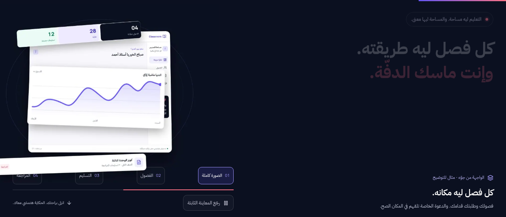

# من فيديو السكرول لمشهد Classroom

فكرة الفيديو الأساسية مش إن كل موقع مبهر لازم يشغّل 3D حي جوّه المتصفح. المثال اللي اتشرح بيعتمد على مشهد متصدّر لسلسلة صور، ورقم الصورة بيتغيّر مع مسافة السكرول. نفس الحركة تقدر ترجع بالعكس لما تطلع. اتعمل تحليل بصري وصوتي للفيديو نفسه، ومنه اتاخدت فكرة التثبيت وتتابع الصور وتفكيك العنصر لطبقات. صور السماعات والأصول اللي في الفيديو ما اتنسختش. [1]

## اللي اتعمل في موقعك

واجهة Classroom الحالية اتصورت واتقسمت لطبقات: شكل الواجهة الأساسي، صف المتابعة، الرسم، وبطاقة الكويز. الطبقات دي اتحركت بزوايا وعمق مختلفين واتصدّرت لسلسلة WebP أصلية. أثناء السكرول، الواجهة بتفتح لطبقات وبعدين بترجع تتجمع، والنص بيشرح الصورة الكاملة والفصول والتسليم والمراجعة. كل الكلام فضل مصري، والحروف العربية ما اتقسمتش ولا اتضغطت عشان الأنيميشن.

على الديسكتوب، المشهد بيثبت في الشاشة خلال مسافة سكرول، من غير سحب تحكّم عجلة الماوس منك أو إجبارك على قفزات بين الأقسام. التثبيت بيشتغل من عرض 1000px وارتفاع نافذة 520px. ربط الحركة بتقدم السكرول والعكس عند الرجوع هو نفس نمط scroll-driven animations اللي موضح في مرجع Chrome. هنا اتنفّذ بمستمع passive وrequestAnimationFrame وحساب تقدم القسم، من غير إضافة GSAP أو Lenis للمشروع. [2]

أزرار مراحل المشهد بتشتغل على الديسكتوب، ومعطلة وإنت موقف الحركة. على الموبايل، مفيش تثبيت طويل: السكرول بيعدّي على معاينة أخف، وأزرار الديسكتوب مش بتظهر كأنها شغالة وهي مش بتغيّر الصورة. تبويبات القصة الأصلية تحت «بتشتغل إزاي» فضلوا زي ما هم. الدخول وإنشاء الحساب والمسارات والدعوات وقاعدة البيانات ما اتغيروش في التحديث ده.

## الحركة من غير تحميل يقفل الموقع

سلسلة الديسكتوب فيها 96 إطارًا بمقاس 960×720، وحجم الإطارات كلها 1,606,740 بايت. الموبايل فيه 48 إطارًا بمقاس 640×480، بحجم إجمالي 437,020 بايت. الأرقام دي أحجام ملفات فعلية، مش قياس سرعة الموقع أو Core Web Vitals.

صورة ثابتة بتظهر من الـserver قبل JavaScript، ومفيش شاشة loading تمنعك من التسجيل أو التصفح. التحميل حسب الإطار المطلوب واللي حواليه، بحد أقصى 3 نقلات متزامنة. الـcache يحتفظ بـ12 إطارًا مفكوكًا للديسكتوب و6 للموبايل، ويقفل الـbitmaps اللي خرجت منه بدل فك السلسلة كلها في الذاكرة. لو إطار اتأخر أو فشل، آخر صورة سليمة تفضل موجودة. الخطأ المؤقت ليه محاولة إضافية واحدة بعد فترة تهدئة وطلب لاحق؛ 403 و404 ما بيتكرروش بلا نهاية.

تقليل الحركة محترم افتراضيًا: صورة ثابتة وكل الشرح ظاهر. لو حابب تشوف المؤثرات رغم إعداد الجهاز، دوس «جرّب المؤثرات»؛ ده اختيار جوّه الصفحة ومش بيغيّر إعداد جهازك. تقدر ترجع للمعاينة الثابتة. زر pause الطبيعي بيجمّد الإطار والـlayout ويوقف الطلبات والمستمعات، من غير استمرار حركة في الخلفية. وضع توفير البيانات بيستخدم الصورة الثابتة، وعدم وجود JavaScript ما بيخبيش المحتوى.

## اللي اتأكد فعلًا

نجح TypeScript وESLint والبناء الإنتاجي، و32 اختبارًا في المشروع، منهم حساب تقدم القسم والإطار والعكس، حد النقلات، إلغاء الطلبات، إغلاق الـcache، وفشل الصور والتعافي المحدود. اتفحصت كل صور WebP للتأكد من النوع والمقاس وعدد الإطارات.

اتعمل فحص موجه في Chromium منفصل لنافذة 1280×551 بعد ملاحظة إن شرط الارتفاع القديم كان هيمنع التثبيت في نافذة اللابتوب. التشغيل الاختياري اشتغل رغم reduced-motion؛ منتصف السكرول عرض إطار 47، والرجوع عرض إطار 19. أعلى العنصر المثبت كان 0px. أسفل النص كان 368.47px وأعلى جزء التحكم 424px، فمفيش تداخل. مفيش overflow عرضي ولا أخطاء JavaScript في الفحص ده. أداة My Browser ما دعمتش تنفيذ console، لذلك القياسات دي تخص Chromium المنفصل، مش جلسة متصفح المستخدم.

الفحص ده مش ادعاء إتمام اختبار iOS وAndroid حقيقيين، ولا قياس شبكات بطيئة أو بيانات مستخدمين حقيقية. على شبكة باردة أو ضعيفة، ممكن تتخطّى صور أثناء اللحاق بموضع السكرول، لكن آخر صورة سليمة تفضل ظاهرة. باقي ميزات المنصة اللي لسه بيتكمّل تنفيذها ما اتعلمتش كمنجزة، والمشهد نفسه موسوم كمثال مش بيانات حساب حقيقي. المعاينة شغالة ببناء production محلي داخل Sandbox؛ ده مش نشر عام.

## References

[1]: https://www.youtube.com/watch?v=QMINxTaV9IM "الفيديو المرجعي لتتابع الصور المرتبط بالسكرول"
[2]: https://developer.chrome.com/docs/css-ui/scroll-driven-animations "مرجع Chrome الرسمي للأنيميشن المرتبط بالسكرول"
